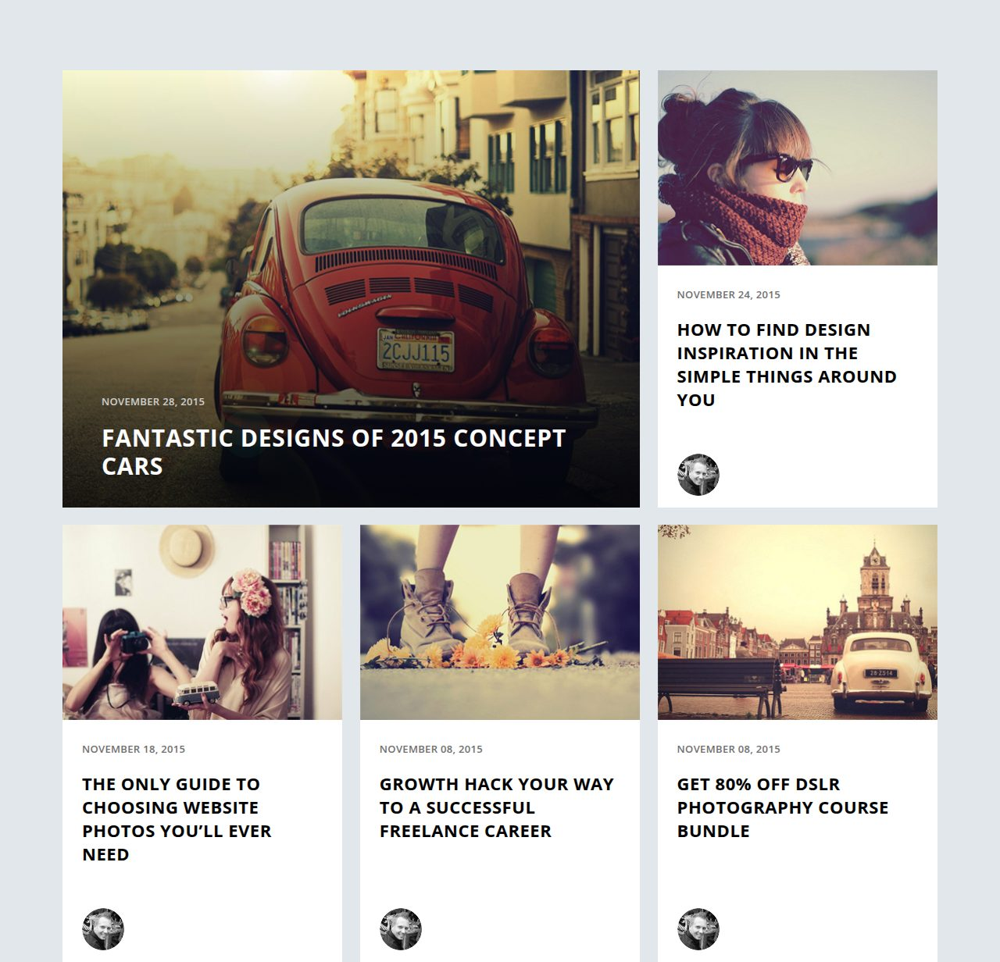
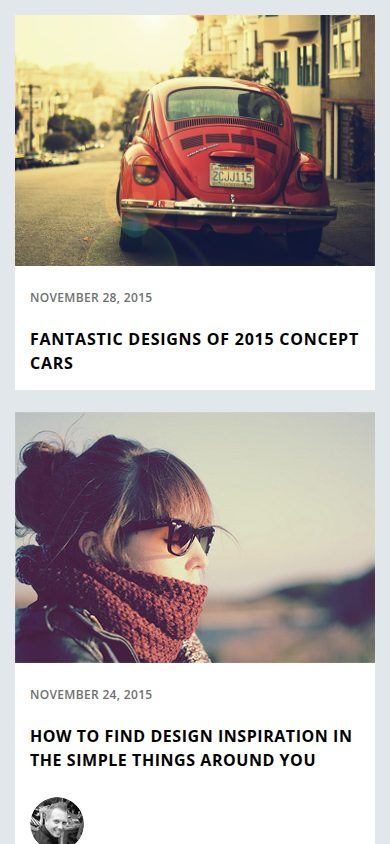

# FlexBox — blog post grid

A responsive grid of blog post cards built with CSS Flexbox (2018 practice project). Plain HTML and CSS,
no JavaScript.

## Screenshots

<table>
  <tr>
    <th>Desktop (1280 px)</th>
    <th>Phone (390 px)</th>
  </tr>
  <tr>
    <td valign="top"></td>
    <td valign="top"></td>
  </tr>
</table>

## How it works

- `.posts` is a wrapping flex row. The featured post takes 66% of the width and the others 32%, so the
  first row holds the featured post and one card, and the next row holds three cards.
- Each card is a flex column. The title pushes the author avatar to the bottom (`margin: … auto`),
  so avatars line up across a row whatever the title length.
- The featured post lays its title over the photo with a dark gradient.

Breakpoints:

| Width | Layout |
|---|---|
| > 768 px | featured post + one card, then three cards per row |
| 481–768 px | two cards per row; the featured post becomes a normal card |
| ≤ 480 px | one card per row |

## Run it

Open `index.html` in a browser, or serve the folder locally:

```bash
python3 -m http.server 8000
# → http://localhost:8000
```

## Structure

```
.
├── index.html
├── css/
│   └── style.css
├── img/                    # Post photos and the author avatar
└── docs/screenshots/       # Screenshots for this README
```

## Notes

Post titles, dates and photos come from a design mockup; the links are placeholders (`#`).

Made by [Ilya Bielov](https://www.facebook.com/MrBiela).
